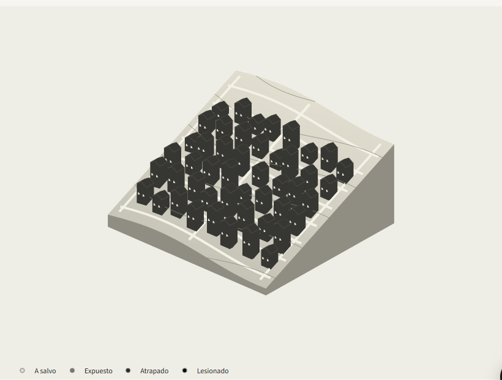
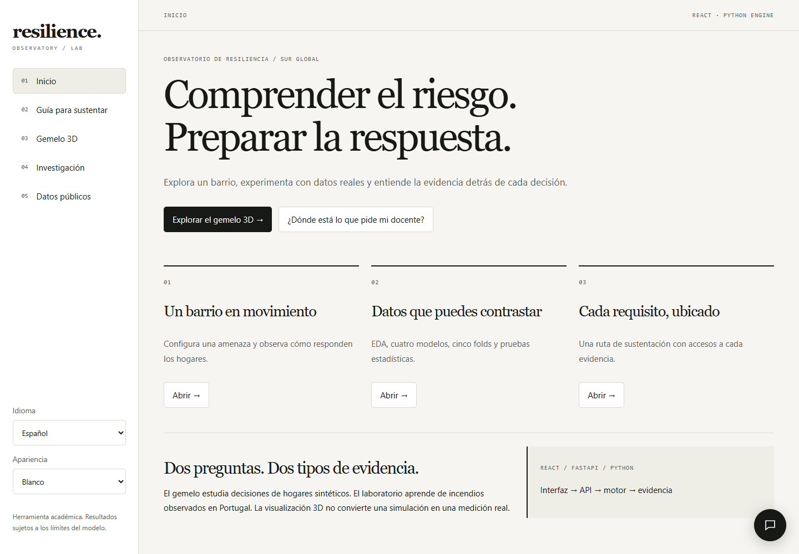
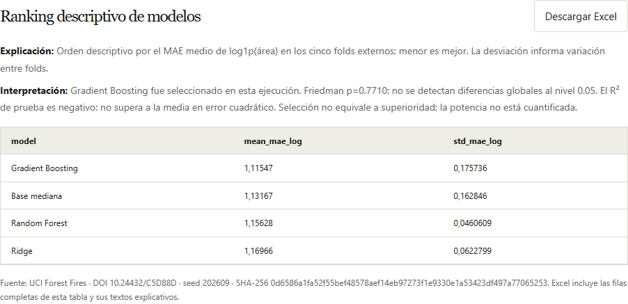

# Gemelo de resiliencia comunitaria

**Explorar un barrio, comparar escenarios y comprender la evidencia.** Una plataforma académica con gemelo poblacional 3D, laboratorio de aprendizaje automático y datos públicos trazables.



**[Abrir presentación visual para el docente](https://alessito123.github.io/gemelo-digital-resiliencia/)** · **[Guía de demostración](docs/PRESENTACION-DOCENTE.md)** · [Alcance de la revisión](docs/COTEJO-REVISION-Y-EXPORTACION-20261026.md)

## Qué puedes hacer

| Espacio | Qué hace la aplicación | Qué puedes mostrar en una sustentación |
|---|---|---|
| **Gemelo 3D** | Simula la respuesta de hogares ante inundación, terremoto, deslizamiento o evento compuesto. | Escenario, evolución temporal, hogares y protocolos derivados. |
| **Investigación** | Recorre CRISP-DM con datos reales de UCI Forest Fires: EDA, entrenamiento y comparación de cuatro modelos. | Cinco folds externos y cinco internos, hiperparámetros, predicciones y diagnósticos estadísticos. |
| **Datos públicos** | Consulta USGS, NASA POWER y OpenStreetMap con fuente y procedencia. | Contexto sísmico, precipitación e infraestructura; no censos individuales. |
| **Exportaciones** | Descarga tablas en Excel e imágenes en alta resolución. | Datos, explicación, interpretación y fuente para los informes. |
| **Guía y asistente** | Ubica requisitos académicos y explica resultados con herramientas locales. | Una ruta de demostración y límites explícitos del modelo. |

## Así se ve

### Un punto de entrada para entender el proyecto



### Resultados que se pueden explicar y exportar



Las capturas corresponden a la aplicación local. La escena 3D representa hogares sintéticos; el laboratorio utiliza un benchmark observado de incendios de Portugal. Son dos tipos de evidencia distintos.

## Recorrido para el docente

1. **Inicio:** conoce el propósito y los espacios de trabajo.
2. **Gemelo 3D:** configura una amenaza, simula y explora hogares y estados.
3. **Investigación:** revisa EDA, entrenamiento, comparación y pruebas estadísticas.
4. **Datos públicos:** consulta las fuentes y su procedencia.
5. **Guía para sustentar:** contrasta cada requisito con su evidencia y pendientes.

La interfaz permite español/inglés, apariencia blanca/negra y un asistente flotante. El motor se ejecuta en Python con FastAPI y LangGraph; el frontend es React.

## Qué significan los resultados

Es un **prototipo de investigación**, con validación científica parcial. El experimento documentado obtuvo R² de prueba **−0.1576** y Friedman **p ≈ 0.771**: no demuestra utilidad operativa ni superioridad estadística entre los modelos. La escena 3D no es una reconstrucción geográfica validada. Los estudios con usuarios, calibración territorial y revisión del manuscrito siguen pendientes.

La presentación web es estática. GitHub Pages puede mostrar esta galería, pero no ejecuta el backend Python. La aplicación completa requiere el servidor descrito en la instalación.

<details>
<summary><strong>Instalación, arquitectura y documentación técnica</strong></summary>

## Aplicación principal: React + FastAPI + Python

La entrada actual es `run_react.py`. React/TypeScript presenta la interfaz y Three.js la maqueta 3D. FastAPI ejecuta el motor Python, LangGraph, el laboratorio scikit-learn y las consultas públicas. El cliente no reimplementa entrenamiento ni decisiones de simulación. Streamlit (`run_python.py`, puerto 8501) y el frontend anterior (`src/App.tsx`) se conservan como referencias.

```powershell
python -m venv .venv-streamlit
.venv-streamlit\Scripts\python.exe -m pip install --only-binary=:all: pip==26.2.1
.venv-streamlit\Scripts\python.exe -m pip install --only-binary=:all: -r requirements-streamlit.txt
.venv-streamlit\Scripts\python.exe run_react.py
```

- Interfaz React: http://127.0.0.1:5178
- API documentada: http://127.0.0.1:8010/docs

Requiere Node/npm y las dependencias del `package-lock.json` además del entorno Python. La API usa 8010 y Vite 5178. Puedes configurarlos mediante `GEMELO_API_PORT` y `GEMELO_WEB_PORT` antes de iniciar el lanzador. Vite reenvía `/api` a FastAPI; no se necesitan credenciales ni CORS abierto.

Para una compilación local servida íntegramente por FastAPI: `npm run build`, seguido de `.venv-streamlit\Scripts\python.exe run_react.py --production`. La interfaz compilada abre en http://127.0.0.1:8010 y sus rutas usan fragmentos (`#twin`, `#guide`, `#research`). `npm run dev` inicia solo Vite; requiere la API activa. `npm run dev:legacy` conserva el servidor Express histórico y no es el flujo principal.

En **Guía para sustentar** encontrarás accesos a los diez requisitos del docente. **Gemelo 3D** ofrece una maqueta con relieve y cubiertas, tres cámaras, calles esquemáticas opcionales y un selector para localizar hogares. El terreno y las calles siguen siendo ilustrativos, no cartografía observada ni rutas calculadas.
- Pruebas: `.venv-streamlit\Scripts\python.exe -m unittest discover -s python_tests -v`

### Espacios de trabajo

1. **Investigación CRISP-DM:** seis fases, EDA de desarrollo, entrenamiento, comparación y predicción.
2. **Gemelo poblacional:** simulación reproducible y orquestación LangGraph, consumidas mediante FastAPI.
3. **Datos públicos:** consultas de USGS, NASA POWER y OpenStreetMap con procedencia y exportación.

### Experiencia visual y asistente

La navegación incluye Inicio, Guía para sustentar, Gemelo 3D, Investigación y Datos públicos. El asistente abre desde un círculo flotante. Los controles de idioma (Español/English) y apariencia (Blanco/Negro) están en la barra lateral. La ejecución de simulación y el entrenamiento se conservan al navegar durante la sesión. Los JSON, la traza, el protocolo y los paneles de datos originales conservan el idioma del motor.

El gemelo 3D permite girar, acercar y recorrer los pasos del motor. Cada edificio representa un hogar estable y recibe su estado individual: expuesto, a salvo, atrapado o lesionado. Terreno y posiciones son esquemáticos, no georreferenciados. Una tabla alternativa muestra los mismos estados. No se presenta como reconstrucción satelital ni modelo físico validado.

El asistente usa herramientas locales: explica métricas, consulta el contexto de entrenamiento y recalcula escenarios con 30 minutos más de alerta. Cita las ejecuciones utilizadas y admite preguntas en español o inglés. Es un asistente de alcance limitado, no un LLM generativo. No emplea credenciales ni envía conversaciones a terceros; conectar un modelo externo requiere autorización.

Especificación de experiencia: [SPEC-experience-3d.md](./SPEC-experience-3d.md).

### Exportar imágenes para informes

En Gemelo 3D, usa **Exportar la vista 3D → Descargar PNG**. Elige 1920 o 3840 px; se captura la cámara, el instante y las capas actuales mediante un render nuevo e incluye una leyenda. En Investigación, cada histograma, matriz de correlaciones, ranking y gráfico real/predicho tiene botones **Descargar PNG** y **Descargar SVG**. SVG es vectorial y mantiene nitidez al ampliarlo. Los archivos incluyen título y procedencia; conservan el idioma y el tema actuales. Las dimensiones efectivas aparecen después de exportar.

### Método del laboratorio

UCI Forest Fires aporta 517 registros observados de incendios de Portugal (Cortez y Morais, DOI 10.24432/C5D88D, CC BY 4.0). Se retiran cuatro duplicados exactos. El objetivo es área quemada, entrenada como log1p(area). Este benchmark no es una validación de resiliencia de asentamientos informales.

Se reserva el 20% de **grupos espaciales** X/Y; el porcentaje de filas puede ser distinto. La semilla 202609 produce 455 registros de desarrollo y 58 de prueba. Solo desarrollo aparece en el EDA. La preparación se ajusta dentro de cada fold.

Se comparan Base mediana, Ridge, Random Forest y Gradient Boosting. La validación anidada usa **5 folds externos y 5 internos**, ambos por grupos espaciales. GridSearchCV ajusta hiperparámetros. Se elige el menor MAE log medio externo y se evalúa únicamente ese modelo sobre la prueba reservada. Se muestran parámetros por fold, todas las combinaciones, dispersión de puntuaciones, MAE/RMSE en hectáreas, R² y predicciones.

Friedman, Wilcoxon pareado con corrección Holm y Shapiro–Wilk se presentan como diagnósticos exploratorios. Cinco folds comparten parte del entrenamiento: no permiten afirmar superioridad universal. El primer experimento seleccionó Gradient Boosting (MAE log externo 1.1155), pero obtuvo R² de prueba −0.1576; Friedman p=0.7710 no indica diferencias significativas.

### Operación y límites

Los servicios escuchan solo en localhost. La primera consulta UCI y las consultas públicas necesitan internet. No se requieren credenciales. Una sola ejecución de entrenamiento puede estar activa; hasta ocho ejecuciones y modelos permanecen en memoria. Cada entrenamiento terminado guarda además un informe JSON en `output/research/`; al reiniciar el servidor hay que entrenar nuevamente para predecir. No se cargan modelos pickle externos.

El laboratorio se limita actualmente a regresión sobre UCI Forest Fires. Los registros USGS/NASA/OSM sirven de contexto y exploración, no se mezclan como etiquetas de resiliencia. Encuestas de campo, calibración histórica de hogares y validación participativa siguen siendo trabajo científico pendiente. La interfaz y todos los servicios del flujo documentado arriba son Python; no se afirma paridad de cada herramienta experimental de la versión React.

Especificación: [SPEC-python-ml.md](./SPEC-python-ml.md). Diseño de API y aprendizaje: [guía de presentación](./docs/PYTHON-CRISP-DM.md).

---

## Referencia histórica: versión React/TypeScript

La descripción y los comandos que siguen pertenecen a la versión anterior. Para ejecutar la entrega Python use el comando de arriba.

Plataforma web de investigación para explorar evacuación, apoyo mutuo, respuesta institucional y recuperación estimada en asentamientos informales. El motor representa las escalas hogar, comunidad y ciudad y permite repetir un experimento mediante una semilla.

> Este software apoya investigación y planificación. No emite alertas oficiales ni sustituye a Defensa Civil, servicios meteorológicos o autoridades locales.

## Qué está implementado

- Motor basado en agentes determinista con escenarios de inundación, terremoto, deslizamiento y evento compuesto sismo–tsunami–infraestructura.
- Acople micro–meso–macro efectivo: señales comunitarias anticipan respuesta institucional; congestión y despeje regresan al comportamiento de hogares.
- Métricas de evacuación, daño, personas afectadas, desplazamiento, pérdida económica y recuperación estimada.
- Fragilidades derivadas en cada ejecución.
- Importación JSON con procedencia y validación de límites.
- Comparación contra evidencia observada o sintética sin confundir ambas.
- Calibración mediante encuesta comunitaria agregada sin información personal.
- Sincronización real y bajo demanda con OpenStreetMap/Overpass, USGS Earthquake Catalog y NASA POWER.
- Calibración pública trazable: accesibilidad cartográfica, lluvia reciente y contexto sísmico modifican únicamente multiplicadores acotados del motor.
- Diagnóstico y protocolos asistidos por Gemini con motor heurístico local cuando no hay clave.
- Orquestación completa con LangGraph: contexto → calibración → simulación → validación → diagnóstico → protocolo → resultado trazable.
- Implementación paralela en Python con Pydantic, LangGraph y una consola científica en Streamlit.

## Datos públicos conectados

El botón **Datos** abre un observatorio que diferencia tres estados: integración en vivo, importación manual y fuente con credenciales. No se afirma que una fuente está integrada si solo existe en el catálogo.

| Fuente | Integración | Consulta aplicada | Uso en el gemelo |
|---|---|---|---|
| OpenStreetMap / Overpass | En vivo, sin clave | Conteos de edificios, vías, salud y puntos de encuentro en una ventana acotada | Índice aproximado de accesibilidad vial |
| USGS Earthquake Catalog | En vivo, sin clave | Radio de 150 km, 10 años, Mw ≥ 3, máximo 50 eventos | Índice contextual sísmico regional |
| NASA POWER Daily | En vivo, sin clave | PRECTOTCORR, 30 días, rezago de 5 días | Amplificador acotado de lluvia y elevación de modelo |
| NASA Global Landslide Catalog | Importación manual | Exportación histórica con condiciones de uso | Validación histórica después de revisión de licencia |
| GHSL, DesInventar, GAR | Importación/ETL | Producto o exportación seleccionada por el investigador | Capas espaciales o validación según esquema |
| EM-DAT, GPM, SRTM/ALOS | Configurable | Cuenta, credencial o pipeline geoespacial según el proveedor | Adaptador pendiente, sin secretos en cliente |

Las ventanas incluidas son aproximadas para demostrar el flujo. Antes de una investigación aplicada deben reemplazarse por polígonos de estudio revisados con la comunidad y el gobierno local.

### Laboratorio IA y análisis avanzado

La sección **Laboratorio IA** incorpora un motor estadístico local para trabajar con una variable numérica a la vez:

- Genera muestras normales o mezclas de 2–3 normales con semilla reproducible y conserva los parámetros sintéticos conocidos.
- Carga series numéricas de USGS Earthquake Catalog y NASA POWER desde las fuentes públicas ya conectadas, sin afirmar que sigan una normal.
- Importa CSV de una columna o JSON de valores, con límites de tamaño, validación de finitud y unidad/procedencia declaradas.
- Ajusta una normal y mezclas gaussianas mediante EM con varias inicializaciones, regularización de varianza y avisos de convergencia.
- Compara AIC/BIC, reserva 20% para evaluación cuando hay al menos 80 registros, y presenta media, mediana, desviación, asimetría, curtosis, histograma y Q–Q.
- Exporta el dataset y el análisis en JSON o los valores en CSV. El cálculo se ejecuta en un Web Worker cancelable para no bloquear la interfaz.

El ajuste es exploratorio y no prueba normalidad, grupos reales ni capacidad de predicción de desastres. Los datos públicos mantienen su fuente, licencia, área, fecha de consulta y limitaciones; un fallo de la fuente se muestra al usuario y no se reemplaza silenciosamente por datos sintéticos.

### API local

- `GET /api/public-data/sources`: conectores operativos.
- `GET /api/public-data/snapshots/:sourceId?settlementId=:id`: snapshot normalizado con métricas, procedencia, licencia y limitaciones.
- `POST /api/engine/runs`: ejecuta el motor reproducible en servidor y devuelve simulación, validación, diagnóstico, protocolo y bitácora del grafo.

El servidor fija los destinos permitidos, limita cada respuesta a 1,5 MB, usa 18 s de timeout, 30 consultas/minuto/IP, caché de 30 minutos y coalescencia de solicitudes simultáneas.

### Motor LangGraph

La pestaña **Motor completo** del asesor abre una sala de orquestación que usa los controles activos del gemelo. Cada ejecución queda identificada por una huella determinista y muestra los nodos recorridos. Si se aporta un dataset observado, el grafo toma la rama de validación; en caso contrario marca correctamente el resultado como ilustrativo.

El sistema no depende de una cuenta externa: sin `GEMINI_API_KEY` emplea el asesor heurístico local. Si la clave ya está configurada por el operador, Gemini se conecta como asesor opcional; sus respuestas se validan y cualquier fallo vuelve automáticamente al motor local.

Ejemplo mínimo:

```json
{
  "settlementId": "medellin-comuna13",
  "scenarioId": "landslide",
  "config": {
    "seed": 202609,
    "hazardIntensity": 8,
    "warningLeadTimeMin": 60,
    "enableMutualAid": true,
    "enableMultiScaleFeedback": true,
    "steps": 20
  },
  "language": "es",
  "includeProtocol": true
}
```

## Ejecutar

Requisitos: Node.js 20 o superior.

```bash
npm install --ignore-scripts
npm run dev
```

Verificación completa:

```bash
npm run check
```

### Versión Python + Streamlit

Esta versión ejecuta un motor Python independiente, no una envoltura de la aplicación React. Incluye los mismos conceptos multi-escala, una traza real de LangGraph, protocolos accionables, validación opcional contra evidencia agregada y exportación JSON. Funciona totalmente en local y no requiere claves ni servicios externos.

En Windows PowerShell:

```powershell
python -m venv .venv-streamlit
.venv-streamlit\Scripts\python.exe -m pip install --only-binary=:all: --requirement requirements-streamlit.txt
.venv-streamlit\Scripts\python.exe -m streamlit run streamlit_app.py --server.port 8501
```

Pruebas del motor Python:

```powershell
.venv-streamlit\Scripts\python.exe -m unittest discover -s python_tests -v
```

La aplicación React permanece en `http://127.0.0.1:3000` y la consola Streamlit utiliza `http://127.0.0.1:8501`, por lo que ambas pueden ejecutarse al mismo tiempo.

## Formato de observaciones

```json
{
  "metadata": {
    "title": "Registro municipal del evento",
    "source": "Defensa Civil",
    "observedAt": "2025-04-02",
    "license": "CC-BY-4.0",
    "evidenceLevel": "observed"
  },
  "observations": [
    {
      "timeMin": 30,
      "evacuationRatePct": 42,
      "structuralDamagePct": 18,
      "affectedPeople": 320,
      "displacedPeople": 70,
      "economicLossUsd": 250000
    }
  ]
}
```

El importador acepta hasta 5.000 observaciones y archivos de 1 MB. Los niveles válidos son `observed`, `calibrated` y `synthetic`.

## Reproducibilidad y límites

- Guarda la ciudad, escenario, intensidad, anticipación, interruptores y semilla usados.
- Los presets incluidos son sintéticos; no representan censos de hogares reales.
- Aplicar datos públicos contextualiza parámetros pero no vuelve “observados” a los hogares sintéticos.
- Las estimaciones económicas y de recuperación requieren calibración local antes de usarse en un estudio.
- “Validado” solo aparece cuando el investigador importa evidencia marcada como observada. Esto confirma una comparación técnica, no una validación científica completa.
- Los talleres comunitarios y la revisión institucional deben realizarse fuera del software y documentarse con aprobación ética cuando corresponda.

Arquitectura y criterios: [SPEC-improvement.md](./SPEC-improvement.md), [CAPABILITY-MAP.md](./CAPABILITY-MAP.md), [CAPABILITY-MAP-ENGINE.md](./CAPABILITY-MAP-ENGINE.md), [SPEC-python-streamlit.md](./SPEC-python-streamlit.md) y [ADR-003](./docs/decisions/ADR-003-python-streamlit-paralelo.md).

## Privacidad y seguridad

La encuesta integrada conserva únicamente agregados y no solicita nombres, teléfonos o coordenadas individuales. Las rutas de IA limitan tamaño y frecuencia, validan entradas y respuestas y no exponen errores internos.

## Licencia

Código bajo licencia MIT. Los datasets externos mantienen sus propias condiciones y deben revisarse antes de redistribuirlos.

## Tablas, figuras y revisión del docente (26 de octubre de 2026)

En el frontend React, cada tabla incluye **Descargar Excel**, explicación, interpretación y fuente. El archivo contiene las hojas **Datos** y **Lectura**; conserva los tipos numéricos y exporta todas las filas de esa tabla. Una vista previa de 30 filas exporta esas 30 filas, no el dataset completo. Los textos se escriben como valores literales, sin ejecutarlos como fórmulas.

Las figuras de investigación y el gemelo 3D incluyen explicación e interpretación, también incorporadas a sus exportaciones de imagen. En **Guía → Revisión del docente · cumplimiento parcial** se encuentra una matriz exportable que relaciona las observaciones del informe con la evidencia y las tareas pendientes.

El cumplimiento científico sigue siendo parcial: el R² de prueba es negativo, los intervalos bootstrap son condicionales y no sustituyen validación operativa, estudios con usuarios, estimación de potencia o revisión del manuscrito. Véase [el cotejo y sus verificaciones](docs/COTEJO-REVISION-Y-EXPORTACION-20261026.md).

</details>
